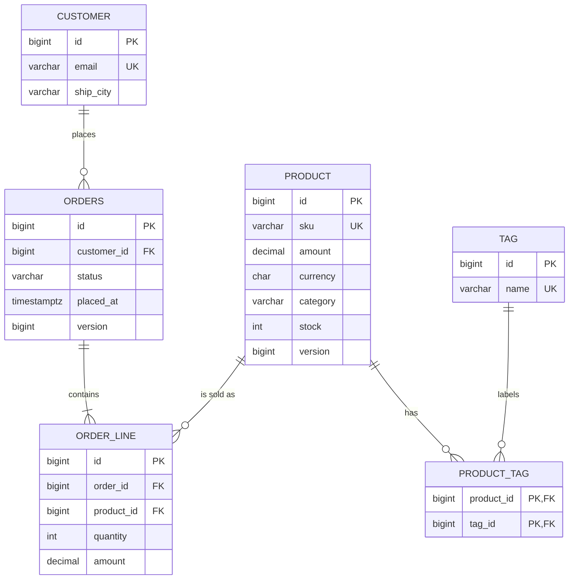

# Challenge: Reporting and Bulk Module

## 1. Product report

Implemented `GET /api/reports/products` with optional `q`, `category`,
`maxPrice`, `minStock`, and `tag` filters, plus a whitelisted `sort`
attribute/direction. For example:

```text
/api/reports/products?category=HARDWARE&minStock=1&tag=sale&sort=amount,desc
```

`ProductReportRepositoryImpl` builds the query directly with the JPA Criteria
API. It uses the generated static metamodel (`Product_`, `Money_`, and `Tag_`),
joins `tags` only when a tag filter is provided, groups the product columns,
and creates `ProductReportRow(sku, name, amount, stock, tagCount)` using
`CriteriaBuilder.construct`. Sort attributes are restricted to `sku`, `name`,
`amount`, `stock`, and `category`.

## 2. Infinite-scroll order feed

The Slice endpoint is `GET /api/orders/feed`; the keyset endpoint is
`GET /api/orders/feed/keyset`. Both accept `size` (default 20, maximum 100)
and an optional `after=<placedAt>,<id>` cursor, and return:

```json
{
  "items": [],
  "nextCursor": null,
  "hasNext": false
}
```

Results are ordered descending by `placedAt` and `id`, so orders with the
same timestamp have a stable tie-breaker. `nextCursor` is `null` when there
is no following window.

Representative Hibernate SQL shapes (parameters shown as `?`; exact aliases
and pagination syntax depend on the Hibernate dialect):

```sql
-- Slice feed. The first request does not need the cursor values.
select o.id, o.customer_id, o.placed_at, o.status, o.version
from orders o
where (? is null or o.placed_at < ?
       or (o.placed_at = ? and o.id < ?))
order by o.placed_at desc, o.id desc
fetch first ? rows only;

-- Keyset feed. The first window omits the seek predicate.
select o.id, o.customer_id, o.placed_at, o.status, o.version
from orders o
where o.placed_at < ?
   or (o.placed_at = ? and o.id < ?)
order by o.placed_at desc, o.id desc
fetch first ? rows only;
```

At offset 100,000, offset pagination has to skip or materialize the preceding
rows. Keyset scrolling instead seeks from the last `(placedAt, id)` values
and reads the requested window. Migration `V3` adds an index on
`(placed_at desc, id desc)` to support that ordering and seek.

## 3. Stock reservation

`StockService.reserve(productId, qty)` loads the product with a pessimistic
write lock, checks availability, and decrements stock within a transaction.
`Product.version` supports the optimistic comparison. The service also
provides an optimistic reservation with retry and an atomic guarded-update
variant:

```sql
update product
set stock = stock - ?, version = version + 1
where id = ? and stock >= ?;
```

The concurrency test runs ten simultaneous reservations against stock 5 for
each strategy. It asserts five successes, five `OutOfStockException`s, and
final stock 0. It logs elapsed time for comparison. ORM-based reservation SQL
has this general form:

```sql
select p.* from product p where p.id = ? for update;
update product
set stock = ?, version = ?
where id = ? and version = ?;
```

## 4. Bulk import

`BulkImportService.importCsv(Path)` reads semicolon-separated records with
header `sku;name;amount;currency;category;stock`. It opens a Hibernate
`StatelessSession`, sets JDBC batch size to 500, and calls `insertMultiple`
for chunks of 500 in one transaction.

`BulkImportTest` generates 50,000 products, measures wall time and sampled
peak heap delta, and verifies the inserted row count for:

1. `StatelessSession.insertMultiple` in 500-row chunks.
2. `saveAll` in one transaction without clearing the persistence context.
3. `saveAll` in one transaction with `flush()` and `clear()` every 500 rows.

Run the stock concurrency and import measurements with:

```powershell
.\mvnw.cmd -q test -Dtest=StockReservationTest,BulkImportTest
```

The elapsed-time and heap results are machine-dependent and should be copied
from the test output. They have not been fabricated or recorded here: this
workspace does not currently have a configured Java runtime (`JAVA_HOME` is
unset), so Maven tests could not be run. Verify the under-10-second H2 import
target on the evaluation machine.

## 5. Schema

There are six physical tables: `customer`, `orders`, `order_line`, `product`,
`tag`, and the `product_tag` many-to-many association table.



## 6. Repository method SQL reference

The following are representative SQL shapes, with bind values shown as `?`.
Hibernate-generated aliases, selected columns, and pagination syntax vary by
dialect. For exact local SQL, enable `org.hibernate.SQL=DEBUG` and
`org.hibernate.orm.jdbc.bind=TRACE`.

| Repository method | SQL shape |
|---|---|
| `CustomerRepository` (no declared query methods) | — |
| `ProductRepository.existsBySku(sku)` | `select p.id from product p where p.sku = ? fetch first 1 row only` |
| `findTop3ByCategoryOrderByPriceAmountDesc(category)` | `select p.* from product p where p.category = ? order by p.amount desc fetch first 3 rows only` |
| `findByTagsName(name)` | `select p.* from product p join product_tag pt on pt.product_id=p.id join tag t on t.id=pt.tag_id where t.name = ?` |
| `findForUpdate(id)` | `select p.* from product p where p.id = ? for update` |
| `decrementStockIfAvailable(id, qty)` | `update product set stock = stock - ?, version = version + 1 where id = ? and stock >= ?` |
| `findLowStock(min)` | `select p.* from product p where p.stock < ? order by p.stock` |
| `findProductReport(...)` | Selects `sku`, `name`, `amount`, `stock`, and the count of product tags; optional predicates and tag joins are added as needed; groups product columns and orders by a whitelisted attribute. |
| `ProductRepository.findAll(specification, pageable)` | `select p.* from product p where [optional predicates] order by ... offset ? rows fetch first ? rows only`, plus a count query for `Page`. |
| `findByCustomerEmailAndStatus(email, status)` | `select o.* from orders o join customer c on c.id=o.customer_id where c.email = ? and o.status = ?` |
| `findByCustomerEmailAndStatusOrderByPlacedAtDesc(email, status)` | `select o.* from orders o join customer c on c.id=o.customer_id where c.email = ? and o.status = ? order by o.placed_at desc` |
| `countByStatus(status)` | `select count(*) from orders o where o.status = ?` |
| `findFirstByCustomerIdOrderByPlacedAtDesc(customerId)` | `select o.* from orders o where o.customer_id = ? order by o.placed_at desc fetch first 1 row only` |
| `findByStatus(status, pageable)` | `select o.* from orders o where o.status = ? order by ... offset ? rows fetch first ? rows only`, plus a count query for `Page`. |
| `findWithLinesByCustomerEmail(email)` | `select distinct o.*, l.*, p.* from orders o join customer c on c.id=o.customer_id join order_line l on l.order_id=o.id join product p on p.id=l.product_id where c.email = ? order by o.placed_at desc` |
| `countLinesByStatus(status)` | `select count(l.id) from order_line l join orders o on o.id=l.order_id where o.status = ?` |
| `findFeedSlice(afterPlacedAt, afterId, pageable)` | The Slice SQL above; no count query. |
| `findAllByOrderByPlacedAtDescIdDesc(position, limit)` | The keyset SQL above; the initial window omits the seek predicate. |
| Inherited `findById(id)`, `findAll()`, `save(entity)`, `delete(entity)` | Select by ID, select all rows, insert or version-checked update, and version-checked delete, respectively; the table depends on the repository entity. |

`ProductService.search` uses `ProductRepository.findAll(specification,
pageable)` with optional name, category, maximum-price, and stock predicates.