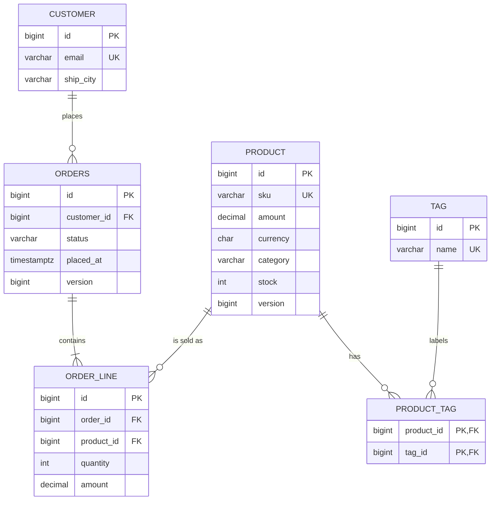

# Shop JPA – Entities, Associations, and Entity Identity

## Task 1 – Entities and Mappings Validated by Flyway

### 1. Entity Mappings

The project uses JPA entities to map Java classes to database tables. Hibernate validates the entity mappings against the database schema managed by Flyway.

### 2. Schema Validation

I tested schema validation by intentionally changing the database schema so that it did not match the entity mappings.

**Test 1: Rename the `sku` column to `code` in SQL only**

Hibernate reported the following error:

```text
Schema validation: missing column [sku] in table [product]
```

This happened because the entity mapping expected a column named `sku`, but the database contained a column named `code`.

**Test 2: Sequence increment mismatch**

I declared the database sequence with `INCREMENT BY 1`, while the entity mapping used an allocation size of 50.

Hibernate reported:

```text
The increment size of the [product_seq] sequence is set to [50]
in the entity mapping but the mapped database sequence increment size is [1]
```

This happened because the sequence increment in the database did not match the allocation size configured in the entity mapping.

These tests demonstrate that Hibernate validates the entity mappings against the database schema.

---

## Task 2 – Associations, Cascading, and Entity Identity

### 1. Order and OrderLine Association

The `Order` entity owns a collection of `OrderLine` entities through a bidirectional one-to-many relationship.

The `Order` entity uses:

- `@OneToMany`
- `mappedBy = "order"`
- `cascade = CascadeType.ALL`
- `orphanRemoval = true`

The `OrderLine` entity uses `@ManyToOne` to reference its `Order`.

The `Order` entity provides methods to manage the relationship:

- `addLine(Product, int)` creates an order line, sets its order reference, and copies the product price into the line's unit price.
- `removeLine(OrderLine)` removes the line from the collection and clears its order reference.
- `getLines()` provides read-only access to the order lines.

### 2. Order Total

The `total()` method calculates the order total by multiplying each line's unit price by its quantity and adding the results together.

An empty order returns zero EUR.

### 3. Product and Tag Many-to-Many Association

The `Product` and `Tag` entities use a bidirectional many-to-many relationship.

- `Product` uses `@ManyToMany` with a join table named `product_tag`.
- `Tag` uses `@ManyToMany(mappedBy = "tags")` as the inverse side.
- Both entities maintain a `Set` to store their associated entities.

The `Product.tag(Tag)` method adds a tag to the product and updates the tag's product collection to keep both sides synchronized.

### 4. Entity Equality and Hash Code

All entities use handwritten `equals()` and `hashCode()` methods.

The equality implementation follows these rules:

- Two entities must be the same class.
- Two entities are equal when both have non-null IDs with the same value.
- Entities with null IDs are not considered equal.
- `hashCode()` returns a constant value for each entity class.

The entity `toString()` methods include scalar fields only and do not include relationships to other entities.

### 5. OrderCascadeTest

The `OrderCascadeTest` uses `@DataJpaTest` and `TestEntityManager` to test persistence, cascading, and orphan removal.

**Persist and reload**

The test creates and persists:

- One customer
- Two products
- One order
- Two order lines

After flushing, the SQL output confirms:

- One `INSERT` into the `orders` table.
- Two `INSERT` statements into the `order_line` table.
- No `UPDATE` statements are needed to establish the initial order-line relationship.

The test then clears the persistence context, reloads the order, and checks its order lines and total.

**Orphan removal**

The test removes one order line from the order and flushes the changes.

The SQL output confirms that Hibernate executes a `DELETE` statement for the removed order line.

**Cascade remove**

The test removes the order and flushes the changes.

The SQL output confirms that Hibernate deletes the remaining order lines and then deletes the order.

### 6. EntityIdentityTest

The `EntityIdentityTest` checks entity equality and hash code behavior.

The test verifies that:

- A persisted `Product` remains findable in a `HashSet` after flushing.
- A product loaded in a new persistence context is equal to the original product.
- The reloaded product is not the same Java object as the original product.

This demonstrates that entity equality is based on persistent identity rather than Java object identity.

### 7. Test Results

The `OrderCascadeTest` and `EntityIdentityTest` were executed.

```text
Tests run: 5, Failures: 0, Errors: 0, Skipped: 0

BUILD SUCCESS
```

All five tests passed successfully.

### 8. Bidirectional Association and toString()

To test the effect of bidirectional relationships in `toString()`, I temporarily modified:

- `Order.toString()` to include its `lines` collection.
- `OrderLine.toString()` to include its `order` reference.

When printing an order, the two `toString()` methods repeatedly called each other because the entities reference each other.

The test resulted in:

```text
ToStringPitfallTest.printOrder » StackOverflow

Tests run: 1, Failures: 0, Errors: 1, Skipped: 0

BUILD FAILURE
```

The stack trace showed repeated calls between `Order.toString()` and `OrderLine.toString()`, causing infinite recursion and a `StackOverflowError`.

After the experiment, both `toString()` methods were restored to include scalar fields only, and the temporary test was removed.

This demonstrates why bidirectional entity relationships should not be included in entity `toString()` methods.

---

## Task 3–5 – Fetch Plans, Query Counting, and JDBC Batching

`ReportService` contains the intentionally naive `linesPerPaidOrder()` implementation and three equivalent alternatives:

| variant | statements | median ms |
|---|---:|---:|
| naive (lazy loop) | 51 | measured locally |
| join fetch | 1 | measured locally |
| `@EntityGraph` | 1 | measured locally |
| `@BatchSize(16)` | 5 | measured locally |

The statement counts are asserted by the N+1 integration test after seeding 50 paid orders with three lines each. `QueryCounter` wraps Hibernate `Statistics`, so the counter measures prepared JDBC statements rather than log lines. The demo test remains tagged `demo` because it intentionally preserves the inefficient implementation as documentation.

The report mapping must read `line.getProduct().getName()` inside the service transaction. If product names are read after the transaction, the product association introduces another N+1 sequence. The configured `hibernate.default_batch_fetch_size=32` caps that sequence at groups of 32; an explicit fetch join/entity graph is still the preferred report-specific solution.

JDBC insert batching is enabled with `hibernate.jdbc.batch_size=50`, `order_inserts=true`, and `order_updates=true`. The sequence-based identifiers allow Hibernate to batch the 1,000 product inserts; the batch test checks 1,000 entity inserts while the prepared-statement count remains well below 1,000. Changing `Product.id` to `GenerationType.IDENTITY` in a scratch branch disables insert batching and makes the counter return to approximately 1,000 because each generated key requires an immediate insert.

`spring.jpa.open-in-view=false` is intentional. Web responses are mapped to DTOs inside a service transaction (`OrderService.findOrdersByCustomerEmail`), so lazy lines and products are initialized before the controller returns. A controller that serializes entities and touches `order.getLines()` after the service transaction would instead fail with `LazyInitializationException` (HTTP 500).

## Task 6–7 – Flyway indexes and query plans

Flyway migration `V2__indexes.sql` adds the indexes used by the order, line, and product access paths:

```sql
CREATE INDEX idx_orders_customer_placed ON orders (customer_id, placed_at DESC);
CREATE INDEX idx_order_line_order ON order_line (order_id);
CREATE INDEX idx_product_category_amount ON product (category, amount);
```

On restart, Flyway applies `2 - indexes`; `flyway_schema_history` then contains the original V1 row and the V2 row. The H2 console can be used to capture the local plans for the paged `/api/orders` query. Before V2, H2 reports a table scan for the unindexed access path; after V2, it can use `idx_orders_customer_placed` for customer/order-date filtering and ordering. Exact plan text is database/version dependent, so the authoritative plans are the ones printed by the H2 console for the current run.
## Reporting, feeds, stock reservation, and bulk import

### Product report

`GET /api/reports/products` accepts any combination of `q`, `category`,
`maxPrice`, `minStock`, and `tag`. `sort` accepts a whitelisted attribute and
optional `asc`/`desc` direction, for example:

```text
/api/reports/products?category=HARDWARE&minStock=1&tag=sale&sort=amount,desc
```

The custom `ProductReportRepositoryImpl` builds the query with JPA Criteria
and generated static metamodel attributes. The product-to-tag join is added to
the main query only when the tag filter is present. `tagCount` uses the
collection-size expression, and the selected columns are projected into
`ProductReportRow` with `CriteriaBuilder.construct`.

### Order feeds

Both feed implementations return `{ items, nextCursor, hasNext }`. The
Slice-based endpoint is `/api/orders/feed`; `/api/orders/feed/keyset` uses
Spring Data's `Window<Order>` scrolling support. Both accept `size` (1–100,
default 20) and `after=<placedAt>,<id>`. Ordering is descending by both
`placedAt` and `id`, so equal timestamps have a stable tie-breaker.
`nextCursor` is `null` when the response has no next window.

Representative SQL shapes (Hibernate binds all values using `?`):

```sql
-- Slice feed. The query has a constant first page and a cursor predicate;
-- Spring Data limits it to size + 1 rows to determine hasNext.
select o.id, o.customer_id, o.placed_at, o.status, o.version
from orders o
where (? is null or o.placed_at < ?
       or (o.placed_at = ? and o.id < ?))
order by o.placed_at desc, o.id desc
fetch first ? rows only;

-- Keyset feed. The first window has no key predicate; subsequent windows
-- seek from the last (placed_at, id) key, without counting skipped rows.
select o.id, o.customer_id, o.placed_at, o.status, o.version
from orders o
where o.placed_at < ?
   or (o.placed_at = ? and o.id < ?)
order by o.placed_at desc, o.id desc
fetch first ? rows only;
```

The first Slice window omits the cursor condition when `after` is absent.
Spring Data can render a keyset window as a lexicographic seek condition (the
exact Boolean form varies by dialect). An offset query at offset 100,000 must
walk/discard roughly 100,000 ordered rows; keyset scrolling starts at the
cursor key and reads only the requested window. Migration `V3` adds an index
on `(placed_at desc, id desc)` to support that seek/order.

### Stock reservations

`StockService.reserve` takes a pessimistic write lock on the product row,
checks availability, and decrements in one transaction. Two comparison
variants are included: `reserveOptimistic` retries version conflicts using the
`Product.version` column, while `reserveAtomic` issues one guarded update:

```sql
update product
set stock = stock - ?, version = version + 1
where id = ? and stock >= ?;
```

The repository includes a 10-caller concurrency test for all three variants.
Each run verifies exactly five successful reservations, five
`OutOfStockException`s, and final stock zero. The test logs elapsed wall time
for direct comparison; the values depend on the machine and database and must
be taken from the test output rather than treated as fixed performance claims.
The ORM-backed variants issue a locked select and a version-checked update:

```sql
select p.* from product p where p.id = ? for update;
update product
set stock = ?, version = ?
where id = ? and version = ?;
```

### Bulk catalogue import

The CSV header is `sku;name;amount;currency;category;stock`. The stateless
importer owns a Hibernate `StatelessSession` and transaction, uses JDBC batches
of 500, and calls `insertMultiple` for each chunk. The comparison variants run
`saveAll` in one transaction, either retaining the persistence context or
flushing and clearing it every 500 rows.

Run the workload and collect machine-specific results with:

```powershell
.\mvnw.cmd -q test -Dtest=StockReservationTest,BulkImportTest
```

`BulkImportTest` creates 50,000 rows and logs wall time and sampled peak heap
delta for all three strategies, and verifies that all 50,000 rows were
inserted. Its measurements are not asserted as fixed thresholds because H2
timings and available heap vary by runtime. The requested sub-10-second
stateless-import target must be verified on the machine used for evaluation.

### Schema diagram

The six physical tables are `CUSTOMER`, `ORDERS`, `ORDER_LINE`, `PRODUCT`,
`TAG`, and `PRODUCT_TAG` (the many-to-many association table):



### Repository method SQL reference

The statements below describe the SQL shapes for the repository methods
declared by this project; generated aliases, selected columns, and pagination
syntax are dialect-dependent. Bind values are shown as `?`. Enable
`org.hibernate.SQL=DEBUG` and `org.hibernate.orm.jdbc.bind=TRACE` to capture
the exact SQL and bindings for the local Hibernate/H2 version.

| Repository method | SQL shape |
|---|---|
| `CustomerRepository` (no declared query methods) | — |
| `ProductRepository.existsBySku(sku)` | `select p.id from product p where p.sku = ? fetch first 1 row only` (existence projection) |
| `findTop3ByCategoryOrderByPriceAmountDesc(category)` | `select p.* from product p where p.category = ? order by p.amount desc fetch first 3 rows only` |
| `findByTagsName(name)` | `select p.* from product p join product_tag pt on pt.product_id=p.id join tag t on t.id=pt.tag_id where t.name = ?` |
| `findForUpdate(id)` | `select p.* from product p where p.id = ? for update` |
| `decrementStockIfAvailable(id, qty)` | `update product set stock = stock - ?, version = version + 1 where id = ? and stock >= ?` |
| `findLowStock(min)` | `select p.* from product p where p.stock < ? order by p.stock` (native query) |
| `findProductReport(...)` | `select p.sku, p.name, p.amount, p.stock, (select count(*) from product_tag pt where pt.product_id=p.id) from product p [join product_tag ... join tag ... when tag is supplied] where [optional predicates] group by p.id, p.sku, p.name, p.amount, p.stock order by [whitelisted column]` |
| `ProductRepository.findAll(specification, pageable)` | `select p.* from product p where [optional specification predicates] order by ... offset ? rows fetch first ? rows only` plus a count query for `Page` |
| `findByCustomerEmailAndStatus(email, status)` | `select o.* from orders o join customer c on c.id=o.customer_id where c.email = ? and o.status = ?` |
| `findByCustomerEmailAndStatusOrderByPlacedAtDesc(email, status)` | `select o.* from orders o join customer c on c.id=o.customer_id where c.email = ? and o.status = ? order by o.placed_at desc` |
| `countByStatus(status)` | `select count(*) from orders o where o.status = ?` |
| `findFirstByCustomerIdOrderByPlacedAtDesc(customerId)` | `select o.* from orders o where o.customer_id = ? order by o.placed_at desc fetch first 1 row only` |
| `findByStatus(status, pageable)` | `select o.* from orders o where o.status = ? order by ... offset ? rows fetch first ? rows only` plus a count query for `Page` |
| `findWithLinesByCustomerEmail(email)` | `select distinct o.*, l.*, p.* from orders o join customer c on c.id=o.customer_id join order_line l on l.order_id=o.id join product p on p.id=l.product_id where c.email = ? order by o.placed_at desc` |
| `countLinesByStatus(status)` | `select count(l.id) from order_line l join orders o on o.id=l.order_id where o.status = ?` |
| `findFeedSlice(afterPlacedAt, afterId, pageable)` | The Slice SQL shown above; no count query |
| `findAllByOrderByPlacedAtDescIdDesc(position, limit)` | The keyset SQL shown above; first position omits the seek predicate |
| Inherited `findById(id)` / `findAll()` / `save(entity)` / `delete(entity)` | `select p.* from product p where p.id = ?`; `select p.* from product p`; `insert into product (...) values (...)` or `update product set ... where id = ? and version = ?`; `delete from product where id = ? and version = ?` (table varies with repository entity) |

`ProductService.search` supplies optional category/name/amount/stock
predicates to `ProductRepository.findAll(specification, pageable)`.

